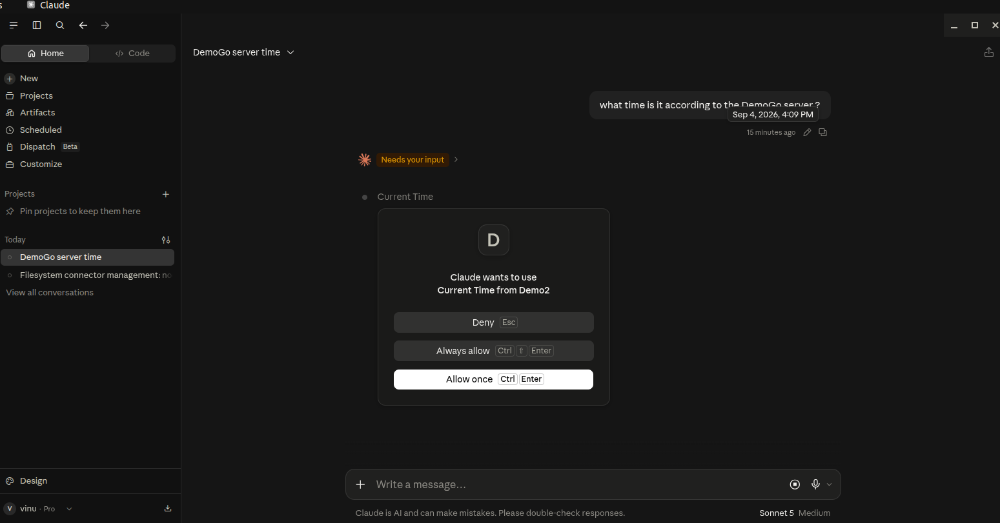

# mcp-go-demo

A minimal MCP server using the official modelcontextprotocol/go-sdk.

Built a small program that exposes some capabilities (two "tools" and one "resource") in a way that an AI application like Claude Desktop can discover and call —
plus two different ways to drive that program to prove it works.


| Piece           | Path                       | What plays the "client"                                                                                                                                                                                                                    |
|-----------------|----------------------------|--------------------------------------------------------------------------------------------------------------------------------------------------------------------------------------------------------------------------------------------|
| **Server**      | `demoserver/server.go`     | - (exposes tools/resources)                                                                                                                                                                                                                |
| **Binary**      | `server.go` (package main) | - runnable program invoked by Claude Desktop                                                                                                                                                                                               |
| **Client demo** | `client/main.go`           | - in-memory/in-process client is not the same server spawned by Claude Desktop.<br/> It's a separate, second way to drive your server — a different client, a different process, no host app involved. Same server code, different driver. |
| **Test suite**  | `demoserver/server_test.go`| `go test`, in-memory                                                                                                                                                                                                                       |

The server offers three things:
- add(a, b) — a tool that adds two numbers
- current_time() — a tool that returns the current time
- greeting://{name} — a resource that produces a greeting for any name


The same server is driven by three different clients:
- Claude Desktop (an AI app, where a model decides when to call the tools)
- Client/main.go (client code calling deterministically)
- Test suite (automated checks)

## Requirements

- **Go 1.25+** (the SDK v1.7.0 requires it).

## Run

```bash
go mod tidy                 # fetch the SDK
go run .                    # run the server over stdio (waits silently — correct)
go run ./client             # drive the server from your own in-memory client
go test ./... -v            # run the test suite
```

## The in-memory transport

Both `client/main.go` and the tests use `mcp.NewInMemoryTransports()`, which
returns a connected client/server pair living in one process — no subprocess, no
stdio, no host app. It's the Go equivalent of FastMCP's `Client(mcp)`, and it's
what makes the tests deterministic: a tool always runs when you call it, so you
assert on the real return value.

```aiignore
vinu@vinu-spectre:~/MCP_GO_DEMO$ go run ./client/
Tools available: add current_time
add(2, 3) -> {"sum":5}
current_time() -> {"time":"2026-09-04T13:35:33.157486241+10:00"}
greeting://Vinu -> Hello, Vinu!
vinu@vinu-spectre:~/MCP_GO_DEMO$ 
```

## Use it in Claude Desktop

Go servers are compiled binaries, so you point Claude Desktop at the built
executable rather than a `python` command:

```bash
go build -o mcp-go-demo .
```

Then add to `~/.config/Claude/claude_desktop_config.json`:

```json
{
  "mcpServers": {
    "DemoGo": {
      "command": "/absolute/path/to/mcp-go-demo"
    }
  }
}
```

Fully restart Claude Desktop, then ask: *"What time is it according to the DemoGo
server?"* — the model can't answer without calling the tool.





## Layout

```
mcp-go-demo/
├── go.mod
├── server.go                    # package main — the stdio binary
├── client/
│   └── main.go                  # in-process client demo
└── demoserver/
    ├── server.go                # importable package: New() builds the server
    └── server_test.go           # go test suite (in-memory)
```

Note the structure: the reusable server lives in an importable package
(`demoserver`), while `server.go` at the root is a thin `package main` wrapper.
Go won't let one `package main` import another, so sharing `New()` between the
binary, the client, and the tests requires it to live in a non-main package —
a small but real Go design lesson.
